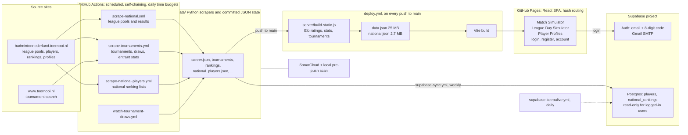

# Architecture

How the badminton analytics app is built. Everything is a static site plus scheduled jobs; the only
live backend is Supabase (login and, increasingly, data).

## Pieces

| Part | Where | What it does |
|---|---|---|
| Scrapers | `data/*.py` | Python standard library plus Playwright for the login and consent cookies. Polite by design: one request at a time, delays, daily time budgets, back-off on any 403/429/503. |
| Scrape state | `data/*.json` | Committed JSON: the resume points and results of every scrape. |
| Scheduled jobs | `.github/workflows/scrape-*.yml` | One daily tick each, then they chain themselves in short runs until their budget is used. |
| Static build | `server/build-static.js`, `server/lib/` | Computes Elo ratings, career stats and tournaments from the JSON and writes `client/public/data.json` and `national.json`. |
| Web app | `client/` | React 18 + Vite on GitHub Pages. Simulations run in the browser from `data.json`. |
| Auth | Supabase Auth | Every page is behind login. Config lives in `supabase/config.toml`. |
| Database | Supabase Postgres | `players` and `national_rankings`, filled weekly by `data/sync_supabase.py` through `supabase-sync.yml`. Row-level security: logged-in users can read, nobody else can, only the service role writes. |
| Quality | SonarCloud, `.githooks/pre-push` | A local scan and all tests run before every push; PRs are scanned again in CI. |

## Where the data layer is going

Today most data still travels as committed JSON and one large `data.json`. The plan is to move it
into Postgres, one entity at a time (national players first), and have the app read single players on
demand instead of downloading everything. See the Supabase migrations in `supabase/migrations/`.

## Network note

The corporate proxy blocks Postgres ports and Docker Hub from the development machine. Database
migrations and syncs therefore run from GitHub Actions, and SQL is tested locally on a Homebrew
PostgreSQL started in a temporary folder.
